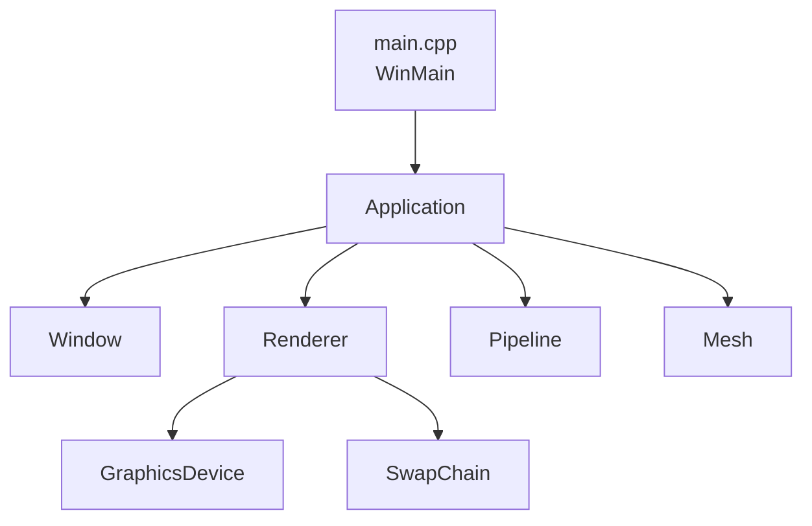
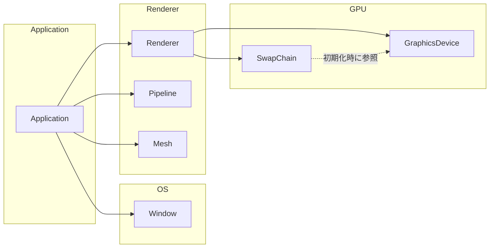

# クラス構成

## 所有関係（誰が誰を持つか）

## フォルダ構成

## 役割
| クラス | 役割 |
|---|---|
| Application | 初期化→ループ→終了の流れ。部品を所有 |
| Window | ウィンドウ作成・メッセージ処理 |
| Renderer | 1フレームの描画の流れを組み立てる |
| Pipeline | どう描くか(シェーダー・描画設定) |
| Mesh | 何を描くか(頂点データ) |
| GraphicsDevice | GPUへの命令送信と完了待ち |
| SwapChain | 画面バッファの管理と表示 |

## クラスごとの詳細
[[Application]] / [[Renderer]] / [[Pipeline]] / [[Mesh]] / [[GraphicsDevice]] / [[SwapChain]]
