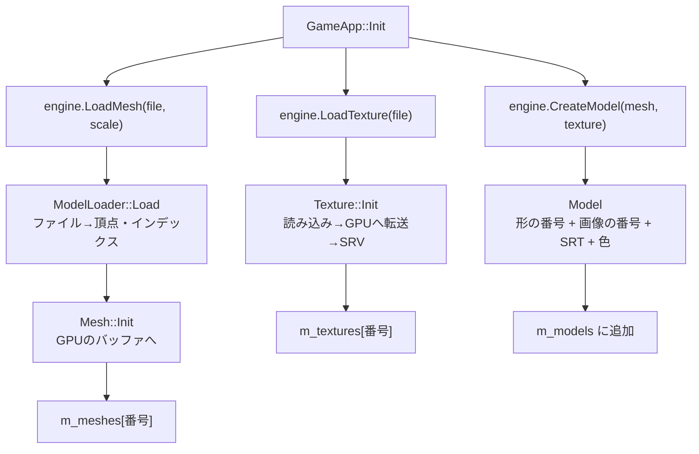
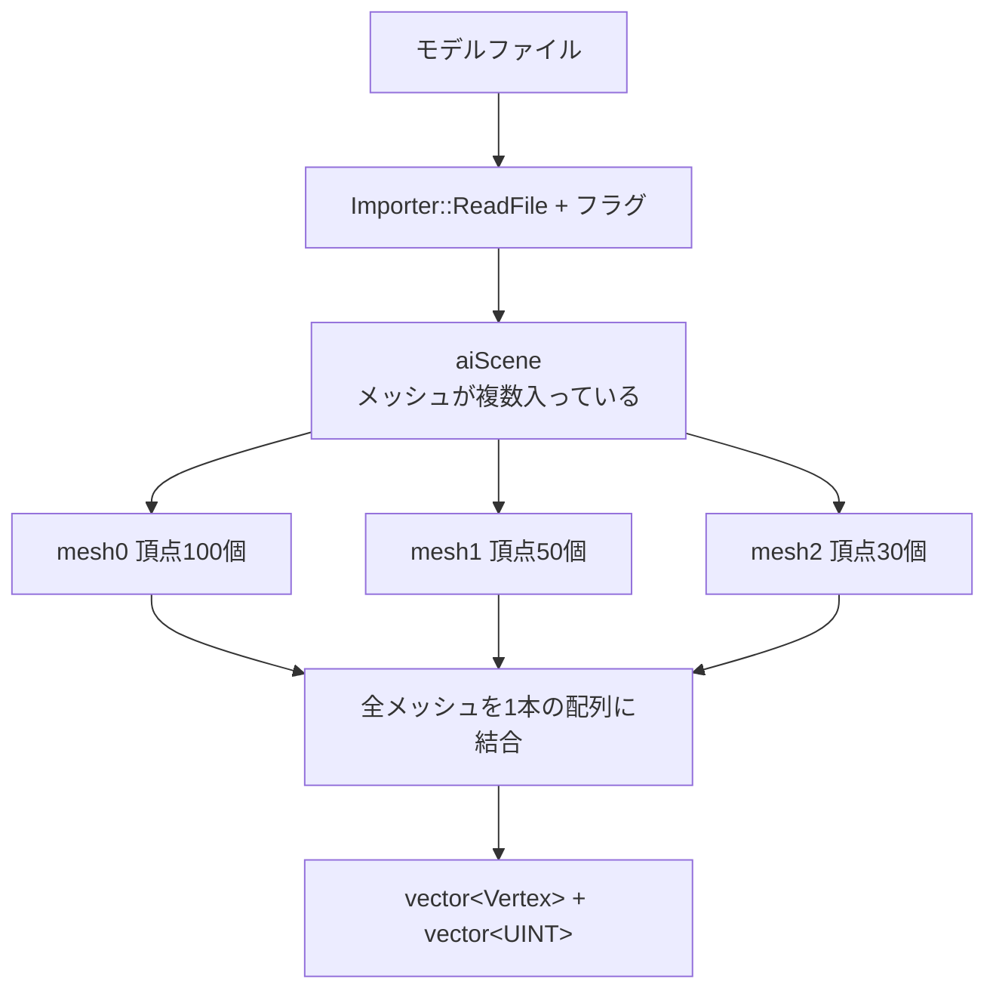
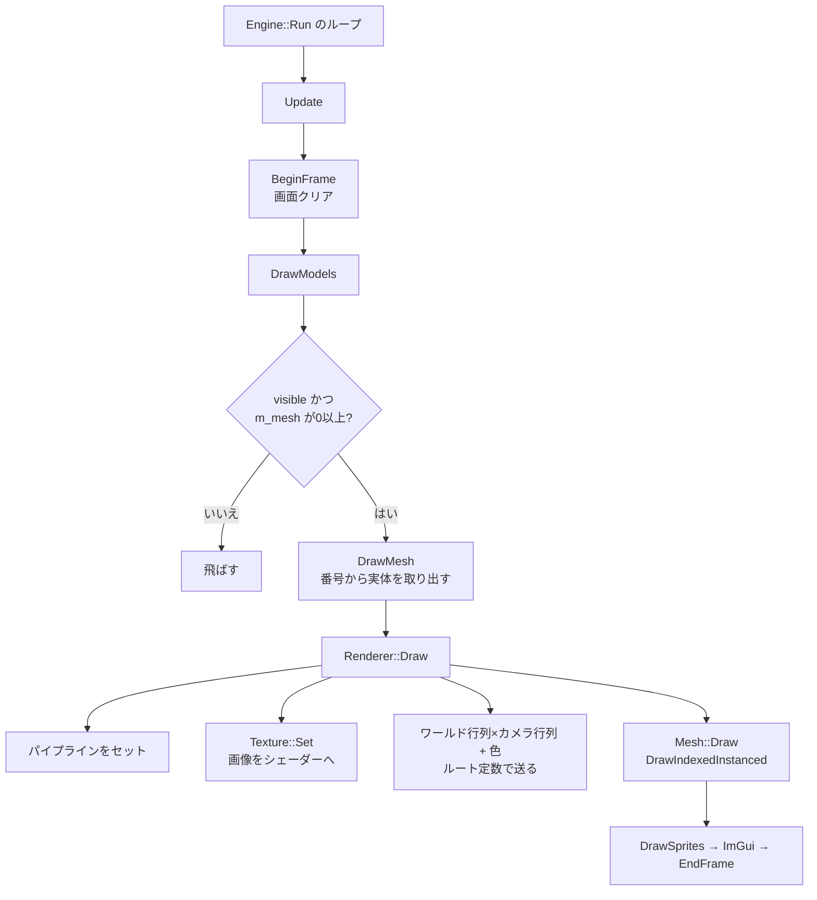
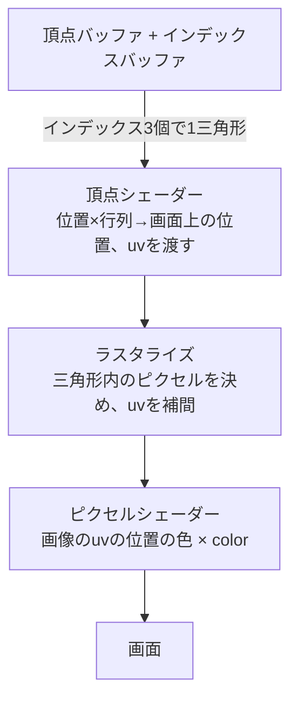
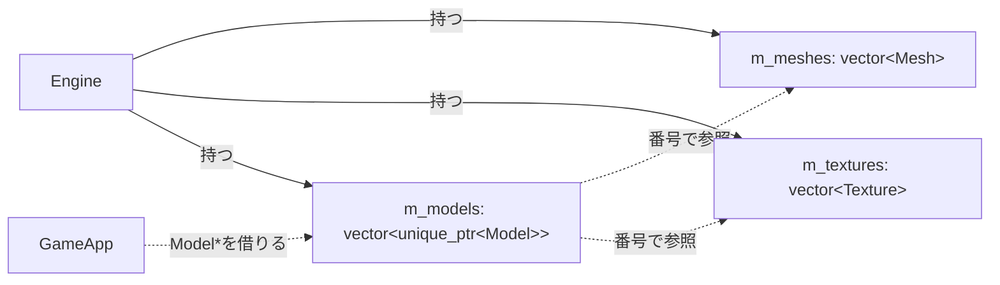

# モデル読み込みの流れ
3Dモデルファイル(fbx, obj)をAssimpで読み、画面に表示するまでの流れ。関連：[[クラス構成]] / [[Mesh]] / [[Renderer]]

## 関係するクラス
| クラス | 役割 |
|---|---|
| `ModelLoader` | ファイル→頂点・インデックスの配列に変換(**Assimpを使うのはここだけ**) |
| `Vertex` | 頂点1個(position / color / uv)。[[Pipeline]]の入力レイアウトと一致させる |
| `Mesh` | 頂点・インデックスをGPUのバッファに持つ |
| `Texture` | 画像1枚をGPUに持つ(DirectXTex) |
| `Model` | 3Dの物1個。形の番号・画像の番号・SRT・色を持つ |
| `Engine` | 形・画像・Modelの一覧を持ち、読み込みと描画を呼ぶ |
| `Renderer` | 描画命令をGPUに出す |
| `GameApp` | ゲーム側。`LoadMesh`→`LoadTexture`→`CreateModel`を呼ぶ |

## 1. 読み込み時(起動時に1回)

- 形と画像は`Engine`の一覧に入り、`Model`は**番号だけ**を持つ
- 同じ形・画像を、複数の`Model`で使い回せる(GPUのメモリは1つ分)

## 2. ModelLoaderの中身(ファイル→配列)


### フラグの役割
| フラグ | 役割 |
|---|---|
| `Triangulate` | 四角形などの面→三角形 |
| `ConvertToLeftHanded` | 左手系・**時計回りが表**・UVの上下反転(DirectXに合わせる) |
| `JoinIdenticalVertices` | 同じ頂点を1つにまとめる(インデックス方式の効果) |
| `PreTransformVertices` | 階層ごとの位置・回転を頂点に焼き込む(ボーン・アニメは失われる) |

### 結合時のインデックスの付け替え(`base`)
```
結合後の頂点配列
  [0 ........ 99][100 ...... 149][150 .... 179]
      mesh0           mesh1          mesh2
      base=0          base=100       base=150

mesh1の三角形 (3, 4, 5) → (100+3, 100+4, 100+5) = (103, 104, 105)
```
- メッシュごとに頂点番号が0から始まるため、結合後の番号にずらす

### 頂点1個の作り方
| ファイル側 | Vertex |
|---|---|
| 位置 xyz | `position` = 位置 × `scale`(cm→mなら0.01) |
| UV | `uv`(無ければ0,0) |
| なし | `color` = 白 |

## 3. 毎フレームの描画

- 読み込みに失敗した形(番号-1)は`DrawModels`で飛ばす

## 4. GPUの中の流れ


## 5. 持ち主と参照

- `Model`は`unique_ptr`でヒープに置く→一覧が伸びてもポインタが動かない
- `m_meshes`は`vector<Mesh>`→再確保でコピーされても、中身は`ComPtr`とビューだけで安全。`Model`は番号で参照するのでポインタが無効にならない

## 課題
- `texture = -1`の`Model`を描くと、`m_textures[-1]`で範囲外アクセスになる(`DrawModels`で`m_mesh`だけ確認している)
- 画像を1枚しか持てない→複数マテリアルのモデルは崩れる
- 法線を読んでいない→ライティングを入れるときに必要
