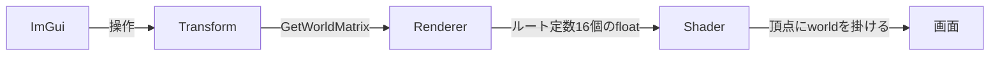
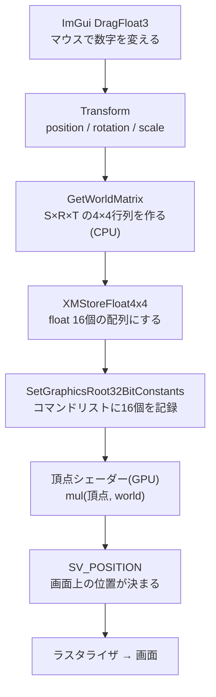

# 三角形のSRT実装手順
ImGuiで三角形の位置・回転・拡大を操作できるようにする。関連：[[クラス構成]] / [[Pipeline]] / [[Renderer]] / [[Mesh]]

## 概念
- **ローカル座標系**：その物体だけの座標。今の頂点(`0.0, 0.5`など)。中心が原点
- **ワールド座標系**：世界全体の座標。物体を置く場所
- **SRT**：Scale(拡大) / Rotation(回転) / Translation(移動)
- **ワールド行列**：ローカル→ワールドに変換する4×4行列。3つの動きを1つにまとめる
- **なぜ4×4か**：移動は掛け算だけでは表せない。座標に4つ目の値(w=1)を足すと、行列の掛け算だけで移動も表せる
- **順序はS→R→T**：拡大と回転は原点中心、最後に移動。逆にすると回転後の位置が原点の周りを回る
- **使うライブラリ**：DirectXMath(Windows SDK同梱、`#include <DirectXMath.h>`だけ)
- **行ベクトル方式**：DirectXMathは`v × S × R × T`の順

## 全体の流れ


## ステップ1：Transformを作る
新規`Math\Transform.h`(`.cpp`は不要)
```cpp
#pragma once
#include <DirectXMath.h>					//行列・ベクトル計算

//位置・回転・拡大を持ち、ワールド行列を作る
struct Transform
{
	DirectX::XMFLOAT3 position = { 0.0f, 0.0f, 0.0f };	//移動
	DirectX::XMFLOAT3 rotation = { 0.0f, 0.0f, 0.0f };	//回転(度) xyz
	DirectX::XMFLOAT3 scale = { 1.0f, 1.0f, 1.0f };		//拡大

	//ローカル→ワールドの行列(S→R→Tの順)
	DirectX::XMMATRIX GetWorldMatrix() const
	{
		using namespace DirectX;
		XMMATRIX s = XMMatrixScaling(scale.x, scale.y, scale.z);
		XMMATRIX r = XMMatrixRotationRollPitchYaw(
			XMConvertToRadians(rotation.x),		//X軸まわり(pitch)
			XMConvertToRadians(rotation.y),		//Y軸まわり(yaw)
			XMConvertToRadians(rotation.z));	//Z軸まわり(roll)
		XMMATRIX t = XMMatrixTranslation(position.x, position.y, position.z);
		return s * r * t;
	}
};
```
- `XMFLOAT3`は保存用、`XMVECTOR`は計算用(メンバに持たせない)
- 回転は度で持つ(ImGuiで直感的)。計算の直前にラジアンへ変換
- `XMMatrixRotationRollPitchYaw`の引数順は(pitch, yaw, roll)。内部ではZ→X→Yの順で回転

**確認**：`Application.h`に`#include "Math/Transform.h"`と`Transform m_triangleTransform;`を足してビルドが通ればOK。ウォッチで`position={1,2,3}`にして`GetWorldMatrix()`の4行目が`(1,2,3,1)`なら正しい

## ステップ2：ルート定数で行列をGPUに渡す
`Pipeline.cpp`の`Init`、ルートシグネチャ部分(`rsDesc`の前に追加)
```cpp
	//ルート定数(行列16個のfloatを直接渡す)
	D3D12_ROOT_PARAMETER param = {};
	param.ParameterType = D3D12_ROOT_PARAMETER_TYPE_32BIT_CONSTANTS;
	param.Constants.ShaderRegister = 0;		//b0
	param.Constants.RegisterSpace = 0;
	param.Constants.Num32BitValues = 16;	//float4x4=16個
	param.ShaderVisibility = D3D12_SHADER_VISIBILITY_VERTEX;	//頂点シェーダーのみ
```
`rsDesc`に追加
```cpp
	rsDesc.NumParameters = 1;
	rsDesc.pParameters = &param;
```
- ルート定数はバッファ不要で、少量のデータに向く
- カメラなど渡すものが増えたら、定数バッファ(CBV)へ移行する

## ステップ3：シェーダーで掛ける
`shaders.hlsl`
```hlsl
cbuffer Transform : register(b0)			//ルート定数
{
    row_major float4x4 world;				//ワールド行列
};
```
`VSMain`の座標変換を変更
```hlsl
    output.pos = mul(float4(input.pos, 1.0f), world);	//ローカル→ワールド
```
- DirectXMathは行優先、HLSLの既定は列優先
- `row_major`を付ければ転置せずに、そのまま渡せる
- `mul(v, M)`の順はDirectXMathの行ベクトル方式と一致

## ステップ4：描画の流れに組み込む
`Renderer.h`
```cpp
#include "Math/Transform.h"
	void Draw(const Pipeline& pipeline, const Mesh& mesh, const Transform& transform);	//描画命令を追加
```
`Renderer.cpp`
```cpp
void Renderer::Draw(const Pipeline& pipeline, const Mesh& mesh, const Transform& transform)
{
	ID3D12GraphicsCommandList* cmd = m_gfx.GetCommandList();
	pipeline.Set(cmd);						//描き方(先にルートシグネチャを設定)

	DirectX::XMFLOAT4X4 world;
	DirectX::XMStoreFloat4x4(&world, transform.GetWorldMatrix());	//計算用→保存用
	cmd->SetGraphicsRoot32BitConstants(0, 16, &world, 0);			//b0へ16個

	mesh.Draw(cmd);							//形
}
```
`Application.cpp`の`Draw`
```cpp
	m_renderer.Draw(m_pipeline, m_triangle, m_triangleTransform);	//三角形
```
- `SetGraphicsRoot32BitConstants`は`pipeline.Set`の後(ルートシグネチャが先)

**確認**：`m_triangleTransform.position.x = 0.3f`などを直書きして、三角形が動けばOK

## ステップ5：ImGuiで操作する
`Application::Draw`の`BeginUI`と`EndUI`の間
```cpp
	ImGui::Begin("Triangle");
	ImGui::DragFloat3("Position", &m_triangleTransform.position.x, 0.01f);
	ImGui::DragFloat3("Rotation", &m_triangleTransform.rotation.x, 0.5f);
	ImGui::DragFloat3("Scale", &m_triangleTransform.scale.x, 0.01f);
	if (ImGui::Button("Reset"))
	{
		m_triangleTransform = Transform();	//初期値に戻す
	}
	ImGui::End();
```
- `&position.x`はxyzが連続して並ぶので、`DragFloat3`にそのまま渡せる
- 日本語ラベルは標準フォントに無いので`???`になる。日本語を使うならフォントの読み込みが必要(後日)

## つまずきやすい点
- **回転すると形が歪む**：画面比(1280×720)を考慮していないため。正常。カメラ(ビュー・プロジェクション行列)で直す
- **X・Y回転で三角形が消える**：裏面カリングが効いている。確認用に`Pipeline`の`CullMode`を`NONE`にする
- **拡大に0を入れると消える**：行列がつぶれる
- **何も動かない**：`SetGraphicsRoot32BitConstants`の呼び出し位置、HLSLの`row_major`、ルートシグネチャの`Num32BitValues=16`を確認

## 次の段階
カメラ：ビュー行列(カメラの位置・向き) + プロジェクション行列(遠近・画面比)

---

# 読み物：なぜSRTが動いたのか

## 0. 一言でいうと
**三角形の頂点データは一度も書き換えていない。** 毎フレーム、頂点に4×4の行列を掛けてから画面に出している。ImGuiで動かしているのは行列の元になる数字(位置・回転・拡大)だけ。

## 1. データの旅(1フレームで起きること)

- 左半分(A〜E)はCPUの仕事、右半分(F〜H)はGPUの仕事
- 2つをつなぐ橋が**ルート定数**(Eの16個のfloat)

## 2. 行列とは何か
- 4×4の行列は**数字16個の表**。頂点`(x, y, z, 1)`に掛けると、新しい頂点`(x', y', z', 1)`ができる
- 「頂点を別の場所に動かす計算」を、1つの表に閉じ込めたもの
- 4つ目の値(w)がある理由は後述(移動のため)

### 拡大行列(Scale)
```
 sx  0   0   0
 0   sy  0   0
 0   0   sz  0
 0   0   0   1
```
- 掛けると`x' = x × sx`、`y' = y × sy`、`z' = z × sz`
- 斜めにだけ数字が入る。`sx = 2`なら、x方向に2倍

### 移動行列(Translation)
```
 1   0   0   0
 0   1   0   0
 0   0   1   0
 tx  ty  tz  1
```
- 掛けると`x' = x×1 + y×0 + z×0 + 1×tx = x + tx`
- **ここで`w = 1`が効く。** 最後の`1 × tx`が足し算になる。これが4つ目の値を持つ理由
- 掛け算だけの仕組み(行列)で、足し算(移動)を表すための工夫

### 回転行列(Z軸まわり、角度θ)
```
 cosθ   sinθ  0   0
 -sinθ  cosθ  0   0
 0      0     1   0
 0      0     0   1
```
- 掛けると`x' = x cosθ − y sinθ`、`y' = x sinθ + y cosθ`
- 画面上で**反時計回り**に回る(正の角度)。`sin`と`cos`が、円周上の位置を表すため
- X軸まわり、Y軸まわりも同じ形。`XMMatrixRotationRollPitchYaw`が、3つを合成して返す

## 3. 具体例：頂点が動く様子
上の頂点`(0, 0.5, 0)`に、拡大2倍・Z回転90度・x方向に+0.3移動をかける。

| 手順 | 計算 | 結果 |
|---|---|---|
| 元の頂点 | | (0, 0.5) |
| 拡大(×2) | 0×2, 0.5×2 | (0, 1.0) |
| 回転(90度) | x' = 0×cos90 − 1×sin90 = −1、y' = 0×sin90 + 1×cos90 = 0 | (−1, 0) |
| 移動(+0.3) | −1+0.3 | **(−0.7, 0)** |

- 画面の上にあった頂点が、左側へ来る。3つの動きが順に適用された
- 順序を逆(移動→回転)にすると、`(0.3, 0.5)`を原点の周りに回すことになり、**まったく別の位置**になる。S→R→Tの順が大事な理由

## 4. なぜ「1つの行列にまとめる」のか
- `頂点 × S × R × T`は、`頂点 × (S × R × T)`と同じ(行列の掛け算は順序を変えずに、括りを変えられる)
- 頂点ごとに3回掛ける代わりに、**CPUで1回だけ合成し、GPUでは1回の掛け算で済む**
- これが`GetWorldMatrix()`で`s * r * t`と書いている理由
- 左から右へ適用されるのは、**DirectXMathが行ベクトル方式**だから(頂点が左側に書かれ、行列を左から順に通る)

## 5. なぜGPUで掛けるのか
- もしCPUで全頂点を計算したら、毎フレーム頂点バッファを書き換えてGPUへ送り直す必要がある
- 今の方法なら、**頂点バッファはそのまま**。送るのは16個のfloat(64バイト)だけ
- 頂点が1万個の3Dモデルでも、送るデータ量は同じ
- 同じ`Mesh`を、別の`Transform`で何度も描ける。敵や弾など、同じ形のものを大量に出すときの基本になる

## 6. ルート定数の仕組み
### ルートシグネチャ＝シェーダーの入力の一覧表
- `Pipeline::Init`で作ったルートシグネチャに「0番目のパラメータ：b0に、32bit値を16個」と登録した
- シェーダー側の`cbuffer Transform : register(b0)`が、この0番目に対応する
- `ShaderVisibility = VERTEX`は、頂点シェーダーにだけ見せるという指定

### `SetGraphicsRoot32BitConstants(0, 16, &world, 0)`の引数
| 引数 | 意味 |
|---|---|
| 0 | ルートパラメータの番号(`b0`のレジスタ番号とは別物) |
| 16 | 渡すfloatの数 |
| &world | 渡すデータの先頭 |
| 0 | 書き込み先のオフセット(今回は先頭から) |

### 呼ぶ順番
- `pipeline.Set(cmd)`の**後**でなければいけない。ルートシグネチャが決まっていないと、「0番目」が何か分からないため
- 値は**コマンドリストに記録された時点でコピーされる。** あとで`Transform`を変えても、すでに記録した描画には影響しない

### バッファ(CBV)との違い
- 定数バッファは、GPUがメモリを読む。CPUが書き換え中にGPUが読むと、**同期の問題**が起きる
- ルート定数は、値が命令そのものに埋め込まれる。**同期を気にしなくていい**
- 大きなデータ(カメラ、ライト、材質など)は、定数バッファに移行する

## 7. `row_major`の意味
- `XMFLOAT4X4`は、メモリ上で**行ごとに4個ずつ**並ぶ(`_11, _12, _13, _14, _21, ...`)
- HLSLの`cbuffer`の既定は**列優先**。同じ16個を「4個ずつの列」として読んでしまう
- 結果として、行列が**転置**されて解釈される(移動量が下の行ではなく右の列にあることになり、動きがおかしくなる)
- `row_major`を付けると、HLSLも行として読む。C++側と一致するので、転置せずに渡せる

## 8. なぜ`XMStoreFloat4x4`が必要か
- `XMMATRIX`は、CPUのSIMDレジスタに乗る型。計算は速いが、メモリに保存する用途には向かない(16バイトのアライメント制約など)
- `XMFLOAT4X4`は、ただのfloat 16個の配列。保存やGPUへの受け渡しに使う
- 「計算するときはXMMATRIX、保存するときはXMFLOAT系」という使い分け

## 9. 今はできていないこと(現象と原因)
### 回転すると形が歪む
- 頂点シェーダーが出力する`SV_POSITION`は**クリップ空間**。xもyも`−1〜1`が画面全体に対応する
- 画面は1280×720で横長。xの「1」とyの「1」は、画面上の長さが違う
- 正方形の座標系を、横長の画面に引き伸ばしている状態。回転で歪んで見える
- 解決は、**プロジェクション行列**でxを`720/1280`倍するアスペクト補正を入れること

### X・Y軸で回すと消える
- パイプラインで**裏面カリング**を有効にしている(時計回りが表)
- Y軸まわり90度で真横(厚み0の線)になり、180度で裏返って反時計回りに見える → カリングされて消える
- 確認したいときは、`CullMode`を`NONE`にする

### 奥行きが関係ない
- `z`は今、意味を持たない。遠近もなく、前後関係を判定する深度バッファもない
- 3Dらしくなるのは、ビュー・プロジェクション行列と深度バッファを入れてから

## 10. 次につながる全体像
今回作った`world`は、3つの行列の最初の1つ。

| 行列 | 役割 | 状態 |
|---|---|---|
| World | 物体を世界に置く(ローカル→ワールド) | 完成 |
| View | カメラから見た座標へ変換 | 未実装 |
| Projection | 遠近・画面比を適用してクリップ空間へ | 未実装 |

最終的には`頂点 × World × View × Projection`になる。カメラを入れても、**ここまでの仕組み(行列の合成 → ルート定数 → シェーダーで掛ける)は同じ**。足すのは、掛ける行列が2つ増えることだけ。

## 11. 設計の振り返り
- **良い点**
  - `Transform`は`Application`(ゲーム側)が持ち、`Renderer`は受け取るだけ。「何を置くか」と「どう描くか」が分かれている
  - `Mesh`は形だけ、`Transform`は置き方だけ。同じ形を別の場所に描ける
  - 頂点データ・シェーダー・行列の役割がそれぞれ独立している
- **今後の課題**
  - 毎フレーム`GetWorldMatrix()`で再計算している。物体が増えたら、変更があったときだけ再計算する方式(ダーティフラグ)を検討
  - オイラー角は、特定の角度で回転軸が重なる**ジンバルロック**が起きる。複雑な回転が必要になったら、**クォータニオン**に移行する
  - 物体が増えたら、`Transform`と`Mesh`を束ねる`GameObject`や`Entity`(ECS)が必要になる
  - `Renderer.h`が`Transform`を`include`している。依存を減らすなら、`Draw`に行列(`XMFLOAT4X4`)を直接渡す設計も選べる
