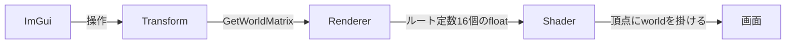

# 三角形のSRT実装手順
ImGuiで三角形の位置・回転・拡大を操作できるようにする。関連：[[クラス構成]] / [[Pipeline]] / [[Renderer]] / [[Mesh]]

## 概念
- **ローカル座標系**：その物体だけの座標。今の頂点(`0.0, 0.5`など)。中心が原点
- **ワールド座標系**：世界全体の座標。物体を置く場所
- **SRT**：Scale(拡大) / Rotation(回転) / Translation(移動)
- **ワールド行列**：ローカル→ワールドに変換する4×4行列。3つの動きを1つにまとめる
- **なぜ4×4か**：移動は掛け算だけでは表せない。座標に4つ目の値(w=1)を足すと、行列の掛け算だけで移動も表せる
- **順序はS→R→T**：拡大と回転は原点中心、最後に移動。逆にすると回転後の位置が原点の周りを回る
- **使うライブラリ**：DirectXMath(Windows SDK同梱、`#include <DirectXMath.h>`だけ)
- **行ベクトル方式**：DirectXMathは`v × S × R × T`の順

## 全体の流れ


## ステップ1：Transformを作る
新規`Math\Transform.h`(`.cpp`は不要)
```cpp
#pragma once
#include <DirectXMath.h>					//行列・ベクトル計算

//位置・回転・拡大を持ち、ワールド行列を作る
struct Transform
{
	DirectX::XMFLOAT3 position = { 0.0f, 0.0f, 0.0f };	//移動
	DirectX::XMFLOAT3 rotation = { 0.0f, 0.0f, 0.0f };	//回転(度) xyz
	DirectX::XMFLOAT3 scale = { 1.0f, 1.0f, 1.0f };		//拡大

	//ローカル→ワールドの行列(S→R→Tの順)
	DirectX::XMMATRIX GetWorldMatrix() const
	{
		using namespace DirectX;
		XMMATRIX s = XMMatrixScaling(scale.x, scale.y, scale.z);
		XMMATRIX r = XMMatrixRotationRollPitchYaw(
			XMConvertToRadians(rotation.x),		//X軸まわり(pitch)
			XMConvertToRadians(rotation.y),		//Y軸まわり(yaw)
			XMConvertToRadians(rotation.z));	//Z軸まわり(roll)
		XMMATRIX t = XMMatrixTranslation(position.x, position.y, position.z);
		return s * r * t;
	}
};
```
- `XMFLOAT3`は保存用、`XMVECTOR`は計算用(メンバに持たせない)
- 回転は度で持つ(ImGuiで直感的)。計算の直前にラジアンへ変換
- `XMMatrixRotationRollPitchYaw`の引数順は(pitch, yaw, roll)。内部ではZ→X→Yの順で回転

**確認**：`Application.h`に`#include "Math/Transform.h"`と`Transform m_triangleTransform;`を足してビルドが通ればOK。ウォッチで`position={1,2,3}`にして`GetWorldMatrix()`の4行目が`(1,2,3,1)`なら正しい

## ステップ2：ルート定数で行列をGPUに渡す
`Pipeline.cpp`の`Init`、ルートシグネチャ部分(`rsDesc`の前に追加)
```cpp
	//ルート定数(行列16個のfloatを直接渡す)
	D3D12_ROOT_PARAMETER param = {};
	param.ParameterType = D3D12_ROOT_PARAMETER_TYPE_32BIT_CONSTANTS;
	param.Constants.ShaderRegister = 0;		//b0
	param.Constants.RegisterSpace = 0;
	param.Constants.Num32BitValues = 16;	//float4x4=16個
	param.ShaderVisibility = D3D12_SHADER_VISIBILITY_VERTEX;	//頂点シェーダーのみ
```
`rsDesc`に追加
```cpp
	rsDesc.NumParameters = 1;
	rsDesc.pParameters = &param;
```
- ルート定数はバッファ不要で、少量のデータに向く
- カメラなど渡すものが増えたら、定数バッファ(CBV)へ移行する

## ステップ3：シェーダーで掛ける
`shaders.hlsl`
```hlsl
cbuffer Transform : register(b0)			//ルート定数
{
    row_major float4x4 world;				//ワールド行列
};
```
`VSMain`の座標変換を変更
```hlsl
    output.pos = mul(float4(input.pos, 1.0f), world);	//ローカル→ワールド
```
- DirectXMathは行優先、HLSLの既定は列優先
- `row_major`を付ければ転置せずに、そのまま渡せる
- `mul(v, M)`の順はDirectXMathの行ベクトル方式と一致

## ステップ4：描画の流れに組み込む
`Renderer.h`
```cpp
#include "Math/Transform.h"
	void Draw(const Pipeline& pipeline, const Mesh& mesh, const Transform& transform);	//描画命令を追加
```
`Renderer.cpp`
```cpp
void Renderer::Draw(const Pipeline& pipeline, const Mesh& mesh, const Transform& transform)
{
	ID3D12GraphicsCommandList* cmd = m_gfx.GetCommandList();
	pipeline.Set(cmd);						//描き方(先にルートシグネチャを設定)

	DirectX::XMFLOAT4X4 world;
	DirectX::XMStoreFloat4x4(&world, transform.GetWorldMatrix());	//計算用→保存用
	cmd->SetGraphicsRoot32BitConstants(0, 16, &world, 0);			//b0へ16個

	mesh.Draw(cmd);							//形
}
```
`Application.cpp`の`Draw`
```cpp
	m_renderer.Draw(m_pipeline, m_triangle, m_triangleTransform);	//三角形
```
- `SetGraphicsRoot32BitConstants`は`pipeline.Set`の後(ルートシグネチャが先)

**確認**：`m_triangleTransform.position.x = 0.3f`などを直書きして、三角形が動けばOK

## ステップ5：ImGuiで操作する
`Application::Draw`の`BeginUI`と`EndUI`の間
```cpp
	ImGui::Begin("Triangle");
	ImGui::DragFloat3("Position", &m_triangleTransform.position.x, 0.01f);
	ImGui::DragFloat3("Rotation", &m_triangleTransform.rotation.x, 0.5f);
	ImGui::DragFloat3("Scale", &m_triangleTransform.scale.x, 0.01f);
	if (ImGui::Button("Reset"))
	{
		m_triangleTransform = Transform();	//初期値に戻す
	}
	ImGui::End();
```
- `&position.x`はxyzが連続して並ぶので、`DragFloat3`にそのまま渡せる
- 日本語ラベルは標準フォントに無いので`???`になる。日本語を使うならフォントの読み込みが必要(後日)

## つまずきやすい点
- **回転すると形が歪む**：画面比(1280×720)を考慮していないため。正常。カメラ(ビュー・プロジェクション行列)で直す
- **X・Y回転で三角形が消える**：裏面カリングが効いている。確認用に`Pipeline`の`CullMode`を`NONE`にする
- **拡大に0を入れると消える**：行列がつぶれる
- **何も動かない**：`SetGraphicsRoot32BitConstants`の呼び出し位置、HLSLの`row_major`、ルートシグネチャの`Num32BitValues=16`を確認

## 次の段階
カメラ：ビュー行列(カメラの位置・向き) + プロジェクション行列(遠近・画面比)
